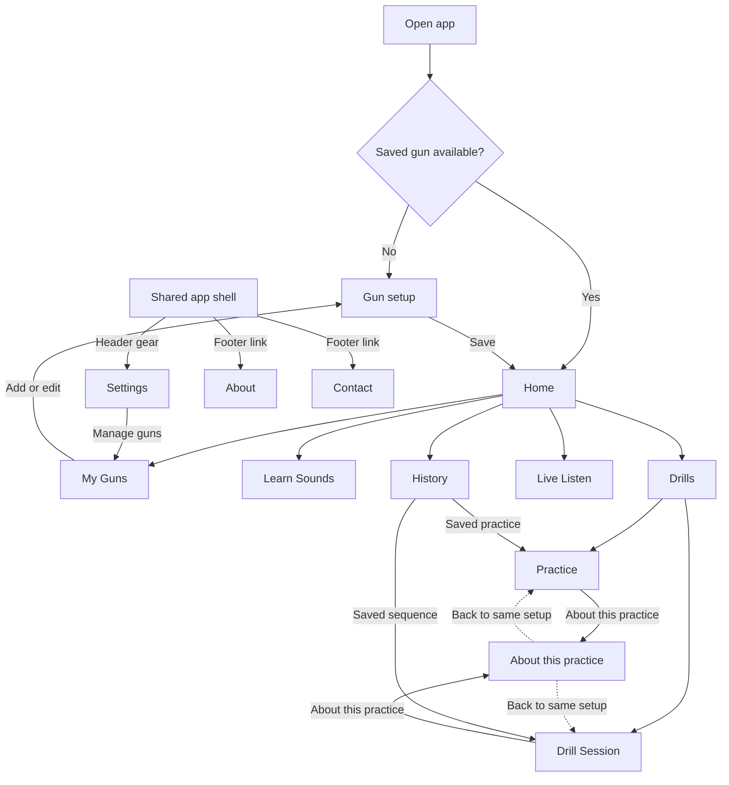

# Application sitemap

Generated from [screen-map.json](screen-map.json). Run `npm run docs:generate` after a navigation change; `npm run docs:check` rejects a stale map. This describes the working app, with 13 screens and 1 shared safety dialog.

## Navigation map

The five bottom tabs are **Home · Learn · Drills · Live Listen · History**. They remain part of the shared shell, including informational pages. Settings opens from the header; About and Contact open from the footer. Gun controls are contextual. Back/Forward return through visited screens; a guide returns to its own source setup with edited values preserved. An operation may be unavailable while capturing or without its required gun/training; the sitemap does not bypass those guards.

## Screen directory

| Screen | App state | Main entry | Current design |
| --- | --- | --- | --- |
| Gun setup | `gunSetupView` | First visit without a gun; Add/Edit from My Guns | [Design](../design/screens/gun-setup/README.md) |
| Home | `homeView` | After gun selection/setup and returning visits | [Design](../design/screens/home/README.md) |
| My Guns | `gunsView` | Active-gun switcher | [Design](../design/screens/guns/README.md) |
| Learn Sounds | `learnView` | Learn tab, Home card or missing-sound link | [Design](../design/screens/learn/README.md) |
| Drills | `drillsView` | Drills tab, Home card or review completion | [Design](../design/screens/drills/README.md) |
| Practice | `practiceView` | Four trigger-mode cards or saved practice review in History | [Design](../design/screens/practice/README.md) |
| Drill Session | `sessionView` | Start Drill on a built-in/custom sequence, or History review | [Design](../design/screens/session/README.md) |
| About this practice | `practiceGuideView` | About this practice link on stopped Practice or Sequence configuration | [Design](../design/screens/practice-guide/README.md) |
| Live Listen | `recognizeView` | Live Listen tab, Home card or Start free listening | [Design](../design/screens/live-listen/README.md) |
| History | `historyView` | History tab or Home card | [Design](../design/screens/history/README.md) |
| Settings | `settingsView` | Settings gear in the shared branded header; backup/restore links | [Design](../design/screens/settings/README.md) |
| About | `aboutView` | Shared app footer → About, including before gun setup | [Design](../design/screens/about/README.md) |
| Contact | `contactView` | Shared app footer → Contact, including before gun setup | [Design](../design/screens/contact/README.md) |

## Main flows

- **First use:** Gun setup → Home. My Guns provides switching, Add/Edit and confirmed deletion of one gun with its owned data.
- **Learn:** required Trigger pull calibration; Draw, Rack and Magazine sounds are optional unless the selected sequence needs them.
- **Trigger Press Group:** Single trigger press, Repeated trigger press, Par-time practice and Trigger control → Setup → Safety if needed → Microphone readiness → Countdown/signal or calibrated external cue → Run → Review/History.
- **Sequence drills:** Rack slide → Trigger pull; Magazine change → Trigger pull; Draw from holster → Magazine change → Trigger pull. Choose a built-in or saved preset → Setup → Safety if needed → Countdown → Ordered detections → Review/History.
- **Guides:** Setup → About this practice → matching short manual/silent example → same Setup. Reading never starts a microphone or records a session.
- **Live Listen:** open the screen → review readiness → Start → consecutive recognized events → Stop. Missing required training is explained on screen.
- **History:** recognition results and saved sessions; open the corresponding Practice/Sequence review. Independent confirmed clear actions have separate scopes.
- **Settings:** audio/appearance preferences and browser support, backup/restore, resets and installation/help. Installation/help is a Settings section, not another route.
- **Contact:** email link to easydryfire@gmail.com. About describes the Beta and invites feedback.

The public edition permits creation of up to two guns and retains existing saved data. Full preview adds custom creation, the higher gun limit, advanced graphs and private Free/Full testing. The screen hierarchy is shared; availability follows [edition requirements](../requirements/build-editions.md).

## Public URLs and indexing

The implemented public path inventory is `https://easydryfire.com/`, `https://easydryfire.com/practice-modes/`, `https://easydryfire.com/single-trigger-press-guide/`, `https://easydryfire.com/repeated-trigger-press-guide/`, `https://easydryfire.com/par-time-practice-guide/`, `https://easydryfire.com/trigger-control-guide/`, `https://easydryfire.com/rack-slide-trigger-pull-guide/`, `https://easydryfire.com/magazine-change-trigger-pull-guide/`, `https://easydryfire.com/draw-magazine-change-trigger-pull-guide/`, `https://easydryfire.com/sequence-drills-guide/`, `https://easydryfire.com/trigger-click-calibration-guide/`, `https://easydryfire.com/help/`, `https://easydryfire.com/about/`, `https://easydryfire.com/contact/`. Public routes have prerendered HTML/metadata. Operational screens use flat noindex paths with history-backed state; personal records are not public pages. This application map does not invent indexable URLs for Settings, sessions or guides. The generated [SEO XML sitemap](../seo/templates/sitemap.xml) and [SEO routing documentation](../seo/README.md) describe indexing; production deployment and crawler decisions remain separate outcomes.

[Complete URL catalog](../seo/routes.md) · [Detailed generated screen/state tree](site-tree.md) · [Architecture and entry point](application-structure.md) · [Maintenance](README.md)
