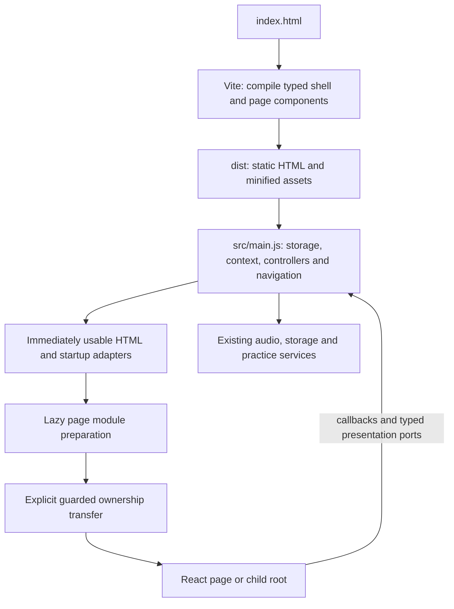

# Application structure and entry points

Architecture handoff, 2026-10-21. Implementation: progressive React with retained startup adapters under [decision001](decisions/001-progressive-react-startup.md). Automated acceptance for the latest implementation must be read from the linked [refactor plan](../project/react-refactor/plan.md); this document is not deployment or hardware evidence.

## Entry points

The browser entry is [src/main.js](../../src/main.js), loaded by [index.html](../../index.html). There is no single top-level client `App.tsx` and no eager `hydrateRoot` for the whole application.

At build time, [vite.config.js](../../vite.config.js) runs [tools/page-templates.mjs](../../tools/page-templates.mjs), which expands the `{{app}}` slot using typed page/shell components. `renderToStaticMarkup` is a build dependency, not a browser startup dependency. [pageDefinitions.js](../../src/pageDefinitions.js) supplies the 13 screen IDs; [screen-map.json](screen-map.json) maps their requirements/designs and generates [site-tree.md](site-tree.md).

At runtime, main initializes storage, active-gun context, preferences, safety/navigation and feature controllers, then displays the usable initial state. [screenNavigation.js](../../src/screenNavigation.js) serializes in-app and browser Back/Forward transitions, stopping capture or preserving failed-save review before leaving. [routeContext.ts](../../apps/web/src/app/routeContext.ts) validates context. Screens are history-backed states at `/`, not separate server URLs.



## Component structure

The authoritative screen/source/controller/test mapping is [component-map.json](component-map.json). Every page/shared UI folder contains its component `.tsx`, colocated `.css`, `.test.tsx` and public `index.ts`. These are isolated source packages within the private `@dryfire/web` and `@dryfire/ui` workspaces, not 40 separately published npm dependencies. `verify:architecture` checks all 40 packages and all 13 screen mappings.

```text
index.html                         HTML/build entry
vite.config.js                     editions, prerender, bundling and minification
apps/web/src/
  app/                             build renderers, lazy mount factories and bridges
    render*.tsx                    build-only static composition
    *Page.tsx / *Contents.tsx       client ownership adapters
    profilePages/index.ts          shared lazy Home / My Guns / Gun Setup entry
    informationBridge.ts           lazy About/Contact and shared chrome bridge
    chromeBridge.ts                header/footer/tab ownership
    retainedPage.tsx               shared parent transfer and rollback
  pages/<Page>/                    one typed screen component, CSS, tests, export
  features/
    history/                       recognition/evaluation and progress models
    live-listen/                   live feedback presentation
    sessions/                      shared live/example run/review presentation
    settings/                      capability and preference presentation
packages/
  ui/src/<Component>/              shared visual/interaction components
  testing/src/                     independent test support; no production imports
src/
  main.js                          application orchestration and startup ports
  *Controller.js                   feature/capture/save ownership
  practiceSession.js               four-mode practice engine
  drillSession.js                  ordered-sequence engine
  sessionPresentation.js           shared live/example adapter contracts
  audio.js / eventDetector.js      microphone capture and segmentation
  classifier.js / recognition.js   sound recognition
  storage.js                       IndexedDB, migrations and backup ownership
  screenNavigation.js              guarded browser/app history
  optional/                        capability-gated custom editor and private graphs
  styles.css                       one ordered stylesheet entry
  templates/                       retained view and feature-island build fragments
workers/                           bundled AudioWorklet, service worker, private asset gate
visual-tests/                      both-edition runtime/visual workflows and frozen evidence
tools/                             build, documentation, package, coverage and performance gates
```

### Screen owners

This table is a readable summary of the authoritative component registry. Controller/test details remain in that registry rather than a second copied inventory.

| Screen state | Typed page source | Colocated style and tests |
| --- | --- | --- |
| `gunSetup` | [GunSetupPage](../../apps/web/src/pages/GunSetupPage/GunSetupPage.tsx) | [CSS](../../apps/web/src/pages/GunSetupPage/GunSetupPage.css) · [tests](../../apps/web/src/pages/GunSetupPage/GunSetupPage.test.tsx) |
| `home` | [HomePage](../../apps/web/src/pages/HomePage/HomePage.tsx) | [CSS](../../apps/web/src/pages/HomePage/HomePage.css) · [tests](../../apps/web/src/pages/HomePage/HomePage.test.tsx) |
| `guns` | [GunsPage](../../apps/web/src/pages/GunsPage/GunsPage.tsx) | [CSS](../../apps/web/src/pages/GunsPage/GunsPage.css) · [tests](../../apps/web/src/pages/GunsPage/GunsPage.test.tsx) |
| `learn` | [LearnPage](../../apps/web/src/pages/LearnPage/LearnPage.tsx) | [CSS](../../apps/web/src/pages/LearnPage/LearnPage.css) · [tests](../../apps/web/src/pages/LearnPage/LearnPage.test.tsx) |
| `drills` | [DrillsPage](../../apps/web/src/pages/DrillsPage/DrillsPage.tsx) | [CSS](../../apps/web/src/pages/DrillsPage/DrillsPage.css) · [tests](../../apps/web/src/pages/DrillsPage/DrillsPage.test.tsx) |
| `practice` | [PracticePage](../../apps/web/src/pages/PracticePage/PracticePage.tsx) | [CSS](../../apps/web/src/pages/PracticePage/PracticePage.css) · [tests](../../apps/web/src/pages/PracticePage/PracticePage.test.tsx) |
| `session` | [SequencePage](../../apps/web/src/pages/SequencePage/SequencePage.tsx) | [CSS](../../apps/web/src/pages/SequencePage/SequencePage.css) · [tests](../../apps/web/src/pages/SequencePage/SequencePage.test.tsx) |
| `practiceGuide` | [PracticeGuidePage](../../apps/web/src/pages/PracticeGuidePage/PracticeGuidePage.tsx) | [CSS](../../apps/web/src/pages/PracticeGuidePage/PracticeGuidePage.css) · [tests](../../apps/web/src/pages/PracticeGuidePage/PracticeGuidePage.test.tsx) |
| `recognize` | [LiveListenPage](../../apps/web/src/pages/LiveListenPage/LiveListenPage.tsx) | [CSS](../../apps/web/src/pages/LiveListenPage/LiveListenPage.css) · [tests](../../apps/web/src/pages/LiveListenPage/LiveListenPage.test.tsx) |
| `history` | [HistoryPage](../../apps/web/src/pages/HistoryPage/HistoryPage.tsx) | [CSS](../../apps/web/src/pages/HistoryPage/HistoryPage.css) · [tests](../../apps/web/src/pages/HistoryPage/HistoryPage.test.tsx) |
| `settings` | [SettingsPage](../../apps/web/src/pages/SettingsPage/SettingsPage.tsx) | [CSS](../../apps/web/src/pages/SettingsPage/SettingsPage.css) · [tests](../../apps/web/src/pages/SettingsPage/SettingsPage.test.tsx) |
| `about` | [AboutPage](../../apps/web/src/pages/AboutPage/AboutPage.tsx) | [CSS](../../apps/web/src/pages/AboutPage/AboutPage.css) · [tests](../../apps/web/src/pages/AboutPage/AboutPage.test.tsx) |
| `contact` | [ContactPage](../../apps/web/src/pages/ContactPage/ContactPage.tsx) | [CSS](../../apps/web/src/pages/ContactPage/ContactPage.css) · [tests](../../apps/web/src/pages/ContactPage/ContactPage.test.tsx) |

### Shared components

[AppShell](../../packages/ui/src/AppShell/AppShell.tsx), [BottomNavigation](../../packages/ui/src/BottomNavigation/BottomNavigation.tsx), [BrandHeader](../../packages/ui/src/BrandHeader/BrandHeader.tsx), [CalibrationCatalog](../../packages/ui/src/CalibrationCatalog/CalibrationCatalog.tsx), [CustomDrillEditor](../../packages/ui/src/CustomDrillEditor/CustomDrillEditor.tsx), [DrillCard](../../packages/ui/src/DrillCard/DrillCard.tsx), [EvaluationPanel](../../packages/ui/src/EvaluationPanel/EvaluationPanel.tsx), [GunSwitcher](../../packages/ui/src/GunSwitcher/GunSwitcher.tsx), [InfoFooter](../../packages/ui/src/InfoFooter/InfoFooter.tsx), [InformationCard](../../packages/ui/src/InformationCard/InformationCard.tsx), [NumberInput](../../packages/ui/src/NumberInput/NumberInput.tsx), [PageHeading](../../packages/ui/src/PageHeading/PageHeading.tsx), [PracticeCatalog](../../packages/ui/src/PracticeCatalog/PracticeCatalog.tsx), [PracticeReview](../../packages/ui/src/PracticeReview/PracticeReview.tsx), [PracticeRun](../../packages/ui/src/PracticeRun/PracticeRun.tsx), [ProgressContent](../../packages/ui/src/ProgressContent/ProgressContent.tsx), [RecognitionList](../../packages/ui/src/RecognitionList/RecognitionList.tsx), [RepetitionResult](../../packages/ui/src/RepetitionResult/RepetitionResult.tsx), [RetainedNode](../../packages/ui/src/RetainedNode/RetainedNode.tsx), [SafetyDialog](../../packages/ui/src/SafetyDialog/SafetyDialog.tsx), [SafetyDisclosure](../../packages/ui/src/SafetyDisclosure/SafetyDisclosure.tsx), [SavedSessionList](../../packages/ui/src/SavedSessionList/SavedSessionList.tsx), [SequenceReview](../../packages/ui/src/SequenceReview/SequenceReview.tsx), [SequenceRun](../../packages/ui/src/SequenceRun/SequenceRun.tsx), [SoundCard](../../packages/ui/src/SoundCard/SoundCard.tsx).

## Runtime ownership and retained boundaries

Most `app/*Page.tsx` adapters create a root with `createRoot` and synchronously commit typed page props. Practice/Sequence parents and their Run/Review children use shared retained-subtree/contents adapters. [RetainedNode](../../packages/ui/src/RetainedNode/RetainedNode.tsx) preserves exact platform-owned subtrees; [retainedPage.tsx](../../apps/web/src/app/retainedPage.tsx) handles parent transfer and recovery. [modulePreparation.js](../../src/modulePreparation.js) caches imports without mounting a page. Loading is not permission to replace active forms or capture state. Two static catalogs retain build-produced inert template nodes. Practice choices move into their existing host after the initial usable screen paints, with a synchronous first-Drills fallback; calibration expands before first Learn rendering. src/staticCatalog.js moves only those trusted nodes once, preserving delegated handlers and current availability. No stored/user HTML is parsed at runtime; the build helper permits only the two known roots and rejects nested scripts.

Shared Practice/Sequence run/review presentation loads on configuration or saved-review entry, before any microphone acquisition/countdown. Both controllers retain the same engines and shared renderers. Loading failure leaves the current screen/data intact and permits retry; navigation, reset and gun changes invalidate pending read tokens. Saved-review errors are reported only while the request is current. Recovery awaits this preparation before showing its read-only review.

Startup adapters are deliberate: they serve immediate data, controls and failed/offline loads before React takes ownership. Guarded updates select one current owner. Mount failure restores prior nodes/listeners/focus. Keep native invalid-number drafts, file input, meter and preview controls intact. Practice/Sequence engine differences and save-retry semantics remain separate even when their presentation is shared. Full History graphs load only when needed, and cannot block saved text or repaint a different gun/route.

The build-renderer files never become client entry points merely because they render the same page type. The initial app payload must not import React client rendering eagerly. [Ownership audit](../project/react-refactor/p7-retained-owner-audit.md) records why the active adapters remain; [memory evidence](../project/react-refactor/p7-memory-owner-evidence.json) records measured overhead and limits without claiming zero leaks.

## Styles, editions and persistent data

[src/styles.css](../../src/styles.css) imports leaf component/page CSS and documented legacy foundation/theme rules in one preserved order. Vite bundles/minifies that cascade. The build-only tools/minify-html.mjs compacts optional quotes/end tags, boolean attributes and normal-layout whitespace through an HTML parser, preserving parsed structure, native values, inline word boundaries, preformatted/raw text and SVG case. Compression adds no browser dependency; the standard Vite module loading order is retained. It adds no browser JavaScript; HTML equivalence tests protect native control values. Shared foundation selectors are still active cross-component styles, not unused files; do not remove them by filename alone. CSS and the 390 image references/83 captures/12 guide GIFs remain governed by exact comparisons. JavaScript, worklet and service worker stay minified, with source maps and raw src modules excluded from deployment.

[build-profile.json](../../build-profile.json), [build-profile.mjs](../../tools/build-profile.mjs) and Vite select public versus private Full preview. Public builds retain existing saved data but exclude private creation/graph/test controls. Private hosted assets require the signed Access gate; a build or Git push does not establish a deployed Access policy. Native mobile deployment, accounts/cloud storage and billing remain outside this refactor.

React UI receives props and callbacks; it does not acquire microphones, IndexedDB or entitlement authority. Storage schemas, backup compatibility, sound labels and per-gun ownership stay with the existing services. Public offline caching includes lazy assets; private preview retires caches without deleting saved data.

## Maintaining this structure

For a changed screen, update component-map.json and screen-map.json, retain unique runtime ownership, add meaningful component/integration tests and preserve the source/CSS/test/export package contract. Update this overview when directory roles or entry points change; do not create a competing component registry. Run typecheck, component/runtime lint, verify:architecture, docs:check, coverage:check, both-edition builds/asset checks and affected browser workflows. Use docs:review only after reviewing changed UI sources; regenerate site-tree with docs:generate. Final implementation acceptance uses the original pinned-image both-edition CI gates. iPhone microphone/beep/vibration testing and live deployment remain separately observed work.

Before a valid gun profile exists, Settings keeps its immediately usable native restore/help/preferences controls and does not fetch the React Settings enhancement. Once a valid profile exists, the existing guarded lazy Settings handoff applies. This avoids loading unused framework code during onboarding; no control or feature is hidden. `visual-tests/startup-settings.spec.js` covers both paths.

### Drills discovery — CHG-054

`tools/page-templates.mjs` renders the four-entry `PRACTICE_MODES` discovery list from `src/practiceModes.js` through `PracticeCatalog`; shared `DrillsPage` titles the section Trigger Press Group. The React handoff reuses the prerendered mode descriptors. Sequence drills are unchanged. CHG-055 removes the two retired engines and uses schema 4 to selectively remove only their sessions/configuration; supported practice/sequence records are preserved. The four-mode list now drives discovery and the engine directly.


CHG-053: `features/live-listen/readiness.ts` is the pure navigation/capture-reason owner. `renderListeningReadiness` supplies native and React Home/Drills/Live Listen ports and shared chrome; the page owns reason-copy metadata. Timing controllers initialize once after a gun profile exists, before its capture/configure flows become available. Empty onboarding retains immediate native controls; restore/reset/background paths safely handle absent timing owners. This preserves first-entry adapters and capture APIs while avoiding unused startup construction.


CHG-058 shared setup: packages/ui/src/DrillSetup exports the configuration shell, numeric card row and ordered steps for both SequencePage and PracticePage. Controller-specific fields are children, not duplicated form shells. Native inputs/listeners and their retained-node handoff stay with the existing page controllers; src/main.js remains the application entry.

Startup reads its gun list, active selection and device preferences from storage.getLibraryOverview: one read-only transaction and one database open, reused after interrupted-session recovery. The existing schema/migration/write owners remain unchanged. Later profile changes request a fresh snapshot; standalone preference reload retains its public API.

CHG-060: apps/web/src/public-site/PublicPage is the four-file public template, composed at build time by tools/public-pages.mjs from site/routes.js. Public content is not eagerly hydrated. The public Worker maps canonical .com public URLs and noindex operational app paths; src/appPaths.js and serialized navigation preserve existing controller guards. Existing13 app pages/26UI packages plus1 public template total40 checked packages. Existing Workers/nonproduction root remains the app; .com root is the public landing. Favicon is derived from the existing app icon.

## CHG-061 public/app routing

`src/main.js` remains the progressive application entry; `src/appPaths.js` supplies flat mode/preset/guide identities. `workers/publicSite.js` maps canonical and compatible legacy HTTP routes. `site/routes.js` owns public metadata/XML/robots; build-only `tools/app-document.mjs` prerenders actual About/Contact/PracticeGuide screens, avoiding a second manual implementation in public output. Root `/` is the real app. `MarketingOverview` is a separate tested/CSS-isolated package reused inside About and the static mode directory; original marketing design is archived. Native/lazy React page ownership, capture, schema and performance contracts remain unchanged.

Startup optimization: `gunPreferenceReads.js` overlaps independent read-only requests for the explicit active gun while consumers retain validation/error order. The root document keeps trusted compiled About content inert; `informationBridge.ts` moves those exact nodes into the existing host synchronously on first About entry, before optional React enhancement. The build expands them for public `/about/` so its initial HTML remains readable without JavaScript. Shared components/styles/final DOM remain unchanged; no new network dependency or data mutation.
