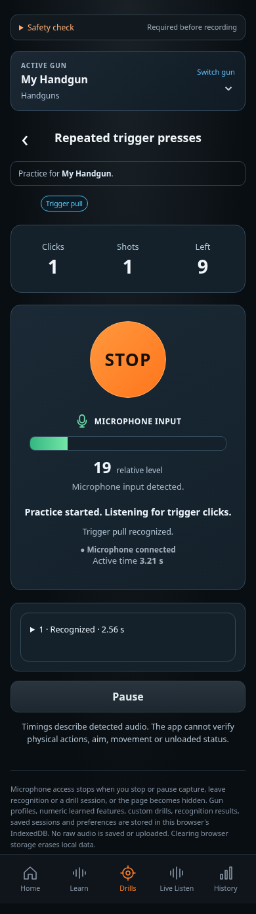
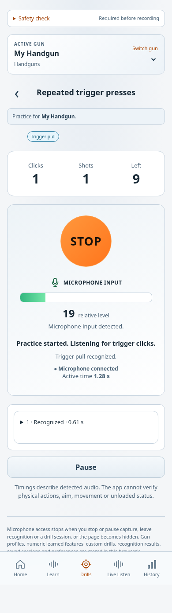

# Practice Run — STOP and microphone input

Revision 1.0 · CHG-016 · 2026-10-11 · Approved by the user's direct instructions. Implementation and publication evidence are tracked separately in [implementation history](../../../project/implementation-history.md).

The corrected layout places **STOP where GO appeared**, with the **microphone indicator directly below STOP**. It applies to all six practice modes and both appearance themes. Existing Configure and Review pages retain their behavior.

| Position | Content and behavior |
| --- | --- |
| Header | Selected gun, practice mode and one copy of its required sound/sequence |
| Counters | Completed attempts/clicks, recognized shots and remaining attempts/time |
| Main control | Large orange STOP button during active practice or external-cue waiting. Ends capture and saves completed and partial results |
| Below STOP | Microphone icon, MICROPHONE INPUT label, live level bar and relative input level; brief real peaks stay visible long enough to notice |
| Feedback | Listening/start status and recognized versus heard-but-unmatched sound feedback. Input level is not recognition confidence and does not count shots |
| Latest result | Most recent repetition's detected timings/results |
| Bottom action | Pause while active; Resume while paused; Next repetition between attempts. End Practice is available when the central STOP is absent |

Before practice starts, the countdown occupies the central position. Pausing, stopping, changing pages or finishing releases capture and clears the live meter. External-cue waiting explains that the calibrated beep has not started the timer. The start beep remains configurable.

The images below are actual captures of the locally verified production-build candidate. Demonstration counts and levels use synthetic test input through the capture pipeline; these images do not establish physical iPhone recognition accuracy or deployment. Requirements are authoritative: [PRACTICE-14 and CHG-016](../../../requirements/practice-modes.md).

| Dark appearance | Light appearance |
| --- | --- |
|  |  |

Five browser checks pass with zero page errors: countdown-to-STOP transition, real input/unmatched feedback, pause/resume/STOP with saved partial results, both themes at 320/390/768 px, and retained results after refresh. STOP is 116 × 116 px; the meter follows it vertically. Older approved Run captures remain preserved in the catalog. Matching implementation and recognition corrections are published to main in [`34d3136`](https://github.com/matosaru/dryfire/commit/34d3136). Final CI/production/device evidence is maintained in the delivery tracker.

The layout uses the app's existing brand and locally authored HTML/CSS/SVG; no third-party application artwork was imported.
