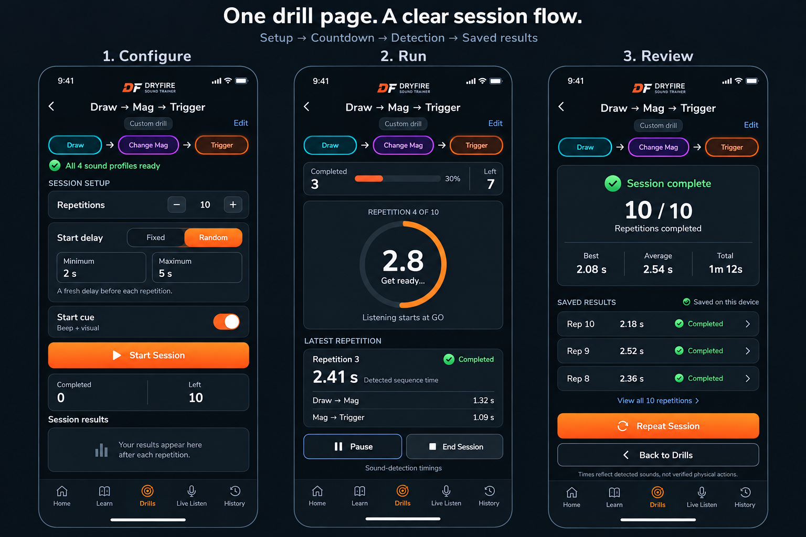

# Drill session page — approved design and controls

This mockup describes three states of one dedicated drill page. The user approved the concrete defaults/control/interruption choices in CHG-014 revision 1.0 by replying **“proceed”** to the published plan. Implementation is complete and locally validated on 2026-10-11; GitHub publication/deployment remain separate. The authoritative behavior is in [drill-sessions.md](requirements/drill-sessions.md) and the [approved plan](requirements/next-implementation.md); see the [design catalog](README.md), [approval log](requirements/approval-log.md) and [implementation history](implementation-history.md).

Actual implementation: [Configure](session-implementation-configure.png), [Run](session-implementation-run.png), [Review](session-implementation-review.png).

- **Configure:** select or edit a drill, set repetitions, choose a fixed or random start delay, and start the session once sound profiles are ready.
- **Run:** show the countdown, completed and remaining repetitions, and the latest repetition result, with Pause and End Session controls.
- **Review:** show the session summary and saved repetition results, with Repeat Session and Back to Drills controls.

Times describe sound detection, not verified physical actions. The mockup contains illustrative sample results.

## Clarified sequence and start controls

- Use **Drill Session** as the page title. Show the complete action sequence once, in the colored sequence strip beneath the title. These chips describe the ordered actions; they are not separate Start buttons.
- Keep the timing breakdowns in a completed repetition's result: they show individual intervals rather than repeating the full drill heading.
- User-approved clarification: rename the ambiguous Start cue control to **Sound at start**, with the explanation **Play a beep when GO appears**.
- With this switch on, play a short beep as each repetition's countdown ends and the visual **GO** signal appears. With it off, show the same countdown and GO signal silently.
- The visual start signal remains available in both modes. The sound switch does not control microphone permission, recording, the start delay or whether a repetition begins.
- Starting the session remains an explicit **Start Session** action. A fixed or random delay is applied before each repetition.
- The approved start-sound default is Off. Beep mode uses a disclosed 300 ms detector-input guard to exclude the synthetic cue; very fast actions in that guard may be missed. Silent mode has no guard and both modes measure timing from visual GO.
