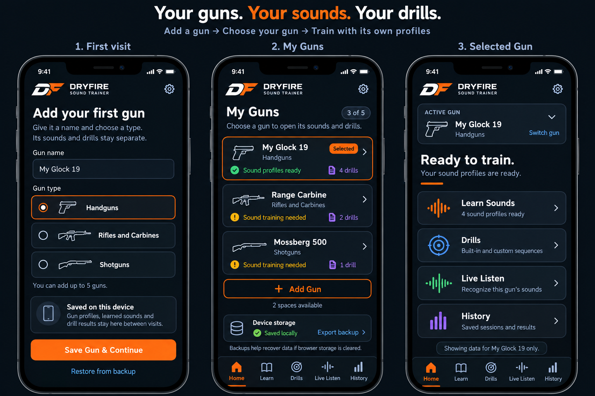
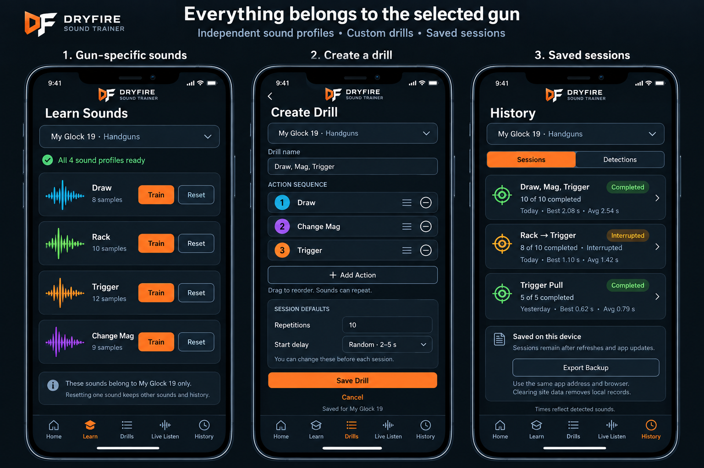

# Multiple guns — proposed front-door flow

The first-visit, library and selected-gun flow was approved by the user. These visualisations describe the accepted proposal. They do not implement gun profiles, custom drill editing, session results or cloud synchronization. Authoritative scope and approval states are in [gun-profiles.md](../requirements/gun-profiles.md), [drill-sessions.md](../requirements/drill-sessions.md) and [persistence.md](../requirements/persistence.md). See the [design catalog](README.md) for reviewed visual revisions.

## First visit, library and selected-gun Home

[Open full-size front-door mockup](multiple-guns-front-door.png)

1. With no gun profiles, Home opens **Add your first gun**. The user supplies a gun name and selects exactly one type: **Handguns**, **Rifles and Carbines**, or **Shotguns**. Saving creates the profile and opens its Home dashboard.
2. **My Guns** lists up to five saved profiles, their type, sound-readiness state and drill count. An **Add Gun** button remains available until the five-profile limit is reached.
3. The selected-gun Home dashboard displays its name and type prominently, with a switcher and entries for **Learn Sounds**, **Drills**, **Live Listen** and **History**. All four entries use the selected gun's data.
4. Remember the selected gun between visits. Returning users open its Home dashboard; the switcher opens My Guns.
5. At five profiles, replace Add Gun with a clear **5 of 5 guns saved** message and a profile-management link. Edit or delete a profile from management; deleting a gun and its data requires separate confirmation.
6. The future free version's one-gun restriction is deferred. These mockups show the requested five-profile capacity without subscriptions or upgrade prompts.

## Independent sounds, drills and saved sessions

[Open full-size sounds, drills and history mockup](multiple-guns-sounds-drills-history.png)

- Show the selected gun's name on Learn, Drills and History so data ownership is always visible.
- Learned sound samples and classification use only that gun's profiles.
- Built-in drill definitions can be shared; custom presets, session configuration and results belong to one gun.
- Custom drill creation supports a name, ordered actions, repeated actions and editable session defaults. The session page uses the previously proposed [Configure / Run / Review flow](drill-session.md).
- Proposed session detail: prevent switching gun profiles during recording or an active session. Exact end/pause/switch behavior remains to be confirmed; never silently assign results to another gun.
- Reset one sound only for the selected gun. Reset all sounds for this gun preserves its session history and every other gun's data. Deleting an entire profile is a separate confirmed action.
- Gun type is descriptive metadata. The proposal does not silently redefine the app's existing sound identifiers. Sound categories or drill suggestions for different types need to be agreed and validated before implementation.

Names, counts and timings in the mockups are illustrative. Timings describe sound detection, not verified physical actions.

## Persistence needed for refreshes and deployments

The current app stores derived sound feature vectors and recent detections in IndexedDB (`dryfire-sound-trainer`). It does not store playable audio recordings. Its service worker updates cached application files without clearing IndexedDB.

For the requested same-device workflow:

- Keep a stable production origin (scheme, hostname and port), database name and browser/app storage context. Ordinary refreshes and new code deployments at that origin preserve compatible data. Preview domains have separate storage.
- Add a gun-profile store with stable IDs, names and types. Associate learned examples, custom presets, detection events and saved sessions/results with a gun ID. Persist the active gun and per-gun configuration.
- Upgrade the existing schema transactionally. Assign existing sounds and history to one preserved profile and ask the user to name it and select its type; do not guess its type or reset the data.
- Store session summaries and repetition results separately from the recent-detection list, which currently retains only the configured last 1–500 detections. Trimming detections must not erase saved sessions.
- Extend export/import backups to include all gun profiles, sounds, custom drills, configuration, sessions/results and preferences. Retain a migration path for current version-1 backups.
- Request persistent browser storage where supported and report the actual result. This reduces eviction risk but cannot prevent deliberate site-data removal or device loss.

This meets refresh/redeployment persistence on the same origin and device without requiring an account. It is not a guarantee against browser-data deletion, storage eviction or device loss.

For recovery after browser storage is cleared, reinstalling or using another device, add authenticated cloud backup/synchronization. Cloudflare Workers plus D1 is one suitable option for profile metadata, feature vectors, presets and session results, with IndexedDB kept for offline use. It needs account/authentication, ownership checks, synchronization/conflict handling and an accurate sync status. Optional raw recordings would be a separate feature and require suitable file storage.

The recommended first implementation is local-first gun profiles with non-destructive migration and complete export/import backups. Cloud backup can follow if cross-device recovery is required.
