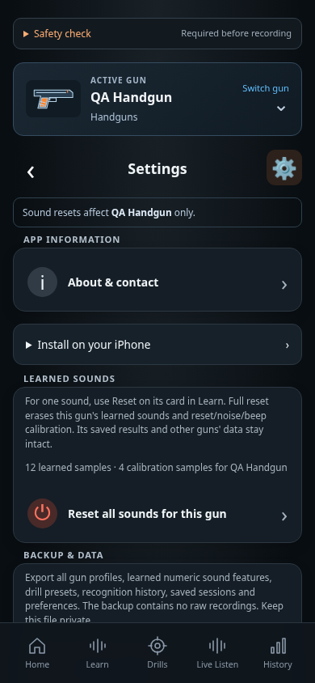

# About link placement proposal

CHG-028 · 2026-10-12 · Suggested layout for review; not an implemented order change.

The user asks: **“about page should have a link inside an app, can you show me your suggested placement ?”** The CHG-027 feature already provides a link near the bottom of Settings. This proposal makes it the first Settings item, above installation information, so a mobile user can find it without scrolling.

## Recommended placement

**Any screen → Settings gear → App information → About & contact.**

Use one full-width row with the information icon, **About & contact** label and chevron. The row opens the existing About screen, which includes `easydryfire@gmail.com`. Keep device capability information at the bottom of Settings. The existing five practice-navigation destinations stay as they are.

## Mobile previews

[Light preview](near-top.light.png).

These 390 × 844 px previews use the built app's components/styles in system Chromium with synthetic gun data. Only the browser DOM was rearranged for this proposal; application source, current accepted screen captures and Chromium/WebKit CI baselines are unchanged. Both themes were checked for horizontal overflow, and the relocated link opens the existing About screen. These illustrative previews are not production/deployment evidence or accepted CI references.

Functional specification: [About and email contact](../../../requirements/about.md). Current implemented layouts: [Settings](../../screens/settings/README.md) and [About](../../screens/about/README.md). The screen hierarchy remains Settings → About; register new actual capture/order only if this proposal is implemented.
