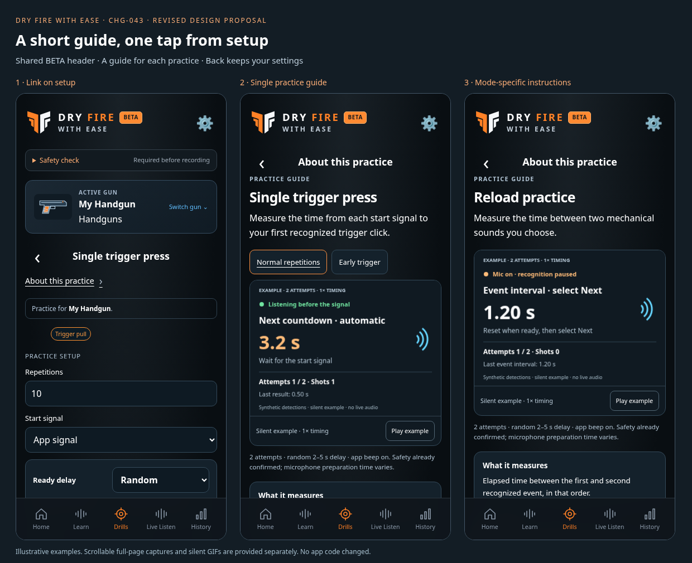
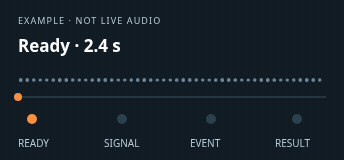
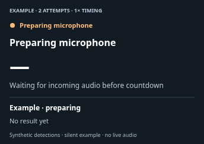

# Practice guide proposal — CHG-042

Revision 0.2 · CHG-042/043 · 2026-10-15 (Europe/Vilnius) · **Proposal for review. Not added to the working app.**

Put an underlined **About this practice ›** link directly below each configuration title, before settings. Use white Dark text, normal Light ink, the existing body-link font and a minimum 44 px touch target. The guide opens as an independent app subpage with the same BETA header, footer/information links and sticky navigation, with Drills active. **Back to setup** returns to the same gun/mode and keeps edited settings; reading never starts the microphone or a drill.

## Page structure

1. Shared header. Setup retains its existing safety/gun context; the informational guide omits those extra controls so the manual appears immediately.
2. Back control, “About this practice”, and the selected practice title.
3. One-sentence purpose and a silent timing illustration with Play/Pause.
4. “What it measures”, three “How it works” steps, “Good to know” and “Before you start”.
5. **Back to setup**, acoustic limitations, then the shared informational footer and fixed five-tab navigation.

The examples retain the existing app's longer scrollable footer. Full-height PNGs below show the complete pages; the overview shows their first screenful. These are design-only HTML renders using the current shared header/footer/navigation and CSS, not screenshots of a shipped feature or accepted pixel-test baselines.

## Reviewable pages

| Practice / sequence | Dark | Light | Silent animation |
| --- | --- | --- | --- |
| Single trigger press | [Page](screens/single.dark.png) | [Page](screens/single.light.png) | [GIF](animations/single.gif) |
| Single: early-trigger example | [Page](screens/single-early.dark.png) | [Page](screens/single-early.light.png) | [GIF](animations/single-early.gif) |
| Repeated trigger presses | [Page](screens/repeated.dark.png) | [Page](screens/repeated.light.png) | [GIF](animations/repeated.gif) |
| Par-time practice | [Page](screens/par.dark.png) | [Page](screens/par.light.png) | [GIF](animations/par.gif) |
| Trigger control | [Page](screens/control.dark.png) | [Page](screens/control.light.png) | [GIF](animations/control.gif) |
| Reload practice | [Page](screens/reload.dark.png) | [Page](screens/reload.light.png) | [GIF](animations/reload.gif) |
| Free practice | [Page](screens/free.dark.png) | [Page](screens/free.light.png) | [GIF](animations/free.gif) |
| Trigger pull (legacy sequence) | [Page](screens/sequence-trigger-only.dark.png) | [Page](screens/sequence-trigger-only.light.png) | [GIF](animations/sequence-trigger-only.gif) |
| Rack → Trigger | [Page](screens/sequence-rack-trigger.dark.png) | [Page](screens/sequence-rack-trigger.light.png) | [GIF](animations/sequence-rack-trigger.gif) |
| Magazine → Trigger | [Page](screens/sequence-mag-trigger.dark.png) | [Page](screens/sequence-mag-trigger.light.png) | [GIF](animations/sequence-mag-trigger.gif) |
| Draw → Magazine → Trigger | [Page](screens/sequence-draw-mag-trigger.dark.png) | [Page](screens/sequence-draw-mag-trigger.light.png) | [GIF](animations/sequence-draw-mag-trigger.gif) |
| Saved custom sequence example | [Page](screens/sequence-custom.dark.png) | [Page](screens/sequence-custom.light.png) | [GIF](animations/sequence-custom.gif) |

Link placement: [Single Dark](screens/single-setup.dark.png) · [Single Light](screens/single-setup.light.png) · [Sequence Dark](screens/sequence-rack-trigger-setup.dark.png) · [Sequence Light](screens/sequence-rack-trigger-setup.light.png).

The setup mockups demonstrate the proposed link and preserve the current practice fields. The sequence setup illustration reuses the field styling for link placement; its full sequence form is not a replacement proposal. Product implementation must retain the existing ordered-session controls/defaults. Reload endpoints and custom steps in a real guide must come from the selected configuration/preset snapshot. The shown profile name, counts and timings are fixtures.

## Animation direction

CHG-043 replaces the original four-second concept with **1× timing examples driven by the actual pure session engines**. Each scene shows microphone state, countdown or elapsed time, attempts/clicks and the latest outcome. A small discrete pulse marks a synthetic recognized event; the decorative waveform is removed. Example configurations are disclosed below the animation: two attempts, three clicks or a six-second Free session, with random 2–5-second delays and app beep enabled. These small example targets do not change application defaults.

- **Single:** microphone preparation, 2.4-second countdown, visual beep, first accepted click at 0.50 seconds, then an automatic 3.2-second countdown/beep and another click at 0.60 seconds. Finish at two attempts. The successful result remains visible during the fresh countdown.
- **Early Single:** a recognized click 0.50 seconds before the pending signal fails attempt one, adds no shot and has no successful reaction time. There is no beep for that aborted countdown. A fresh countdown starts automatically; the next beep/click completes attempt two. Normal/Early controls select independent clips and restore the static poster.
- **Repeated/control:** one beep, three distinct clicks, 0.80-second consecutive intervals and completion at the click target.
- **Par:** one in-time click, an explicit example user selection of Next, then a fresh countdown/beep and a no-click miss. The deadline and processing of previously captured audio remain separate.
- **Reload:** Rack at 0.40 seconds and Magazine at 1.60 seconds produce a 1.20-second event interval and zero shots; user selects Next before another countdown.
- **Free:** one beep, three clicks within the labeled six-second example duration, a deadline/finishing state and three clicks over six active seconds in Review.
- **Ordered sequences:** both full repetitions, their real step order, one-second result hold and automatic next countdown. The existing sequence runner connects its microphone before countdown but arms event detection at GO; it does not inherit Single's pre-beep failure rule.

**Separate early-trigger example:**

[Scenario source](scenarios.mjs) imports the unchanged production session engines; [recorded timelines](scenario-timelines.json) retain source hashes, chosen configuration, signal/event times, outcomes and encoded duration. The captures use 100 ms frames, and each exported GIF's frame count/duration is checked against the scenario. The one-second microphone preparation is illustrative, not a readiness guarantee. Safety confirmation and learned sounds are assumed; no real microphone/classifier, audio-output latency or asynchronous save delay is simulated. A visual BEEP label represents the signal; the GIF intentionally has no sound. These examples explain application behavior, not physical technique or measured device accuracy. No competitor media or external artwork is imported.

Each GIF loops as a demonstration after showing Review with **Microphone stopped**. The actual practice stops at its target; it does not automatically start a new session from Review.

The prototype initially shows a static poster, including with reduced motion; **Play example** starts the GIF and **Pause** restores the poster. Text steps provide the same essential explanation. A later app implementation should use a small controlled SVG animation if it preserves meaning/accessibility and is lighter than bundled GIFs. No autoplay sound, microphone permission or third-party media service.

## Copy, source and validation

- [Short manual text for every type](copy.md), generated from [manuals.json](manuals.json).
- [Proposed requirements and internal navigation tree](../../../requirements/practice-guides.md).
- [Interactive HTML prototype](index.html): download/open it with its `animations/` folder, or serve the repository locally. GitHub displays source rather than running HTML; use the PNG/GIF links above for browser review.
- [Renderer](render.mjs), [Canvas illustration source](motion.html), [engine-driven scenarios](scenarios.mjs), [scenario timelines](scenario-timelines.json), [capture/check script](capture.mjs) and [observed validation](validation.json).

The [validation report](validation.json) records the final observed revision checks: mode/sequence coverage, readiness/timing/counting/Next assertions, all 12 GIF durations, 28 page screenshots, 66 responsive guide layouts, Play/Pause/variant controls and edited-setting return journeys. These are proposal checks; product CI and physical microphone/device validation remain separate. The previous CHG-042 four-second examples are superseded and retained in [`b84de36`](https://github.com/matosaru/dryfire/commit/b84de36).

Reproduce from the repository root with `node docs/design/proposals/practice-guides/capture.mjs`. Requires installed Playwright, a Chromium executable (`CHROMIUM_EXECUTABLE_PATH`, default `/usr/bin/chromium`) and FFmpeg/FFprobe. It uses a temporary local server and stops it when done. No product routes, source files, build profiles, accepted screenshot references or stored user data are modified. The app's twelve-screen registry continues to describe implemented behavior; add the guide state and pinned capture coverage only with actual implementation.

Review scope: link placement/style, common page structure, all mode-specific copy, and the silent animation direction. Once this proposal is accepted, implement one reusable guide template/catalog, navigation guards and context retention, then refresh actual product screenshots and pinned browser references. Publication of these mockups does not itself approve or deploy the feature.
