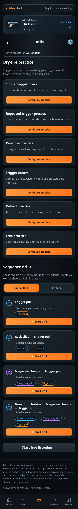

# Drills design

Current implemented layout · CHG-018 coverage audit / CHG-019 corrections · 2026-10-11 · CHG-023 local footer revision; earlier feature baseline [`aacdb18`](https://github.com/matosaru/dryfire/commit/aacdb18); exact reviewed file hashes are in the registry

Entry: Drills tab, Home card or review completion. App anchor: `drillsView`. This is a state of the same `/` web app, not a separate indexable URL.

## Layout and interaction

Six practice cards precede the preserved sequence catalog. Built-in / Custom tabs select sequence presets. The inline custom editor has a title, ordered action list, add/remove/reorder controls, Save and Cancel. A preset is owned by the active gun and uses the existing four event identifiers. The editor is a screen state, not another public route.

Functional specifications: [drill-sessions](../../../requirements/drill-sessions.md) · [practice-modes](../../../requirements/practice-modes.md). These define acceptance behavior and input bounds; the layout here does not introduce a second set of requirement IDs.

## Current visual references

| Screen/state | Capture | App anchor |
| --- | --- | --- |
| Practice modes and built-in sequences | [`catalog.dark.png`](catalog.dark.png) | `practiceCatalog` |
| Saved custom sequences | [`custom.dark.png`](custom.dark.png) | `customDrillCatalog` |
| Create or edit a sequence | [`custom-editor.dark.png`](custom-editor.dark.png) | `customDrillForm` |

Captured from the current local production build in Chromium at a 390 px mobile viewport. QA gun names, sample counts, audio levels and timing statistics are illustrative fixtures. Captures are actual UI rather than generated concepts; they do not establish Cloudflare deployment, real iPhone recognition accuracy or legal clearance. Additional transient/error states use this same layout and the linked requirements.

For a visible change, update the affected captures, this Markdown and the [screen registry](../../../architecture/screen-map.json); run the [maintenance checks](../../../architecture/README.md). Earlier reviewed revisions remain in the [archive](../../archive/README.md) and immutable Git history.
