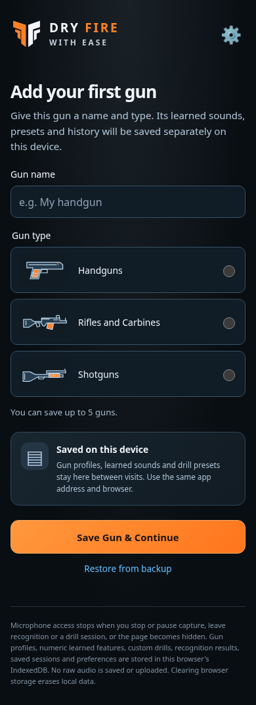

# Gun setup design

Current implemented layout · CHG-018 coverage audit / CHG-019 corrections · 2026-10-11 · application baseline [`b29837a`](https://github.com/matosaru/dryfire/commit/b29837a) plus the CHG-019 candidate; exact reviewed file hashes are in the registry

Entry: First visit without a gun; Add/Edit from My Guns. App anchor: `gunSetupView`. This is a state of the same `/` web app, not a separate indexable URL.

## Layout and interaction

Name (1–80 characters), three illustrated native radio choices for gun type, five-gun capacity, local-storage explanation and Save. Existing-gun Edit prefills the same form with Save Changes and Cancel; saving retains gun identity and all data without changing active selection. First use offers Restore from backup.

Functional specifications: [gun-profiles](../../../requirements/gun-profiles.md) · [persistence](../../../requirements/persistence.md). These define acceptance behavior and input bounds; the layout here does not introduce a second set of requirement IDs.

## Current visual references

| Screen/state | Capture | App anchor |
| --- | --- | --- |
| First gun | [`first-gun.dark.png`](first-gun.dark.png) | `gunForm` |
| Add or edit gun | [`add-gun.dark.png`](add-gun.dark.png) | `gunForm` |
| Edit existing gun, Dark | [`edit-gun.dark.png`](edit-gun.dark.png) | `gunForm` |
| Edit existing gun, Light | [`edit-gun.light.png`](edit-gun.light.png) | `gunForm` |

Captured from the current local production build in Chromium at a 390 px mobile viewport. QA gun names, sample counts, audio levels and timing statistics are illustrative fixtures. Captures are actual UI rather than generated concepts; they do not establish Cloudflare deployment, real iPhone recognition accuracy or legal clearance. Additional transient/error states use this same layout and the linked requirements.

For a visible change, update the affected captures, this Markdown and the [screen registry](../../../architecture/screen-map.json); run the [maintenance checks](../../../architecture/README.md). Earlier reviewed revisions remain in the [archive](../../archive/README.md) and immutable Git history.
