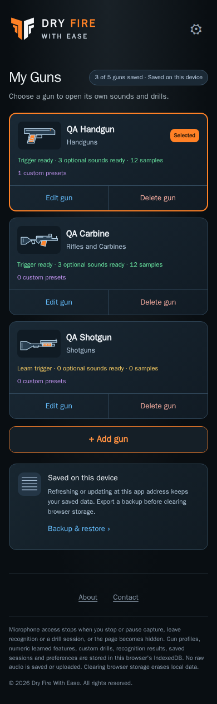

# My Guns design

Current implemented layout · CHG-020 deletion/clear correction · 2026-10-11 · exact reviewed UI source hashes are in the registry; published source [`7240e2c`](https://github.com/matosaru/dryfire/commit/7240e2c); external CI/deployment evidence is in the project tracker

Entry: Active-gun switcher. App anchor: `gunsView`. This is a state of the same `/` web app, not a separate indexable URL.

## Layout and interaction

Illustrated library cards show gun name/type, readiness, selected status and capacity out of five. Each has separate Select, Edit and Delete actions; no nested buttons. Edit/Delete share an action row with 44 px minimum targets. Delete names the gun in a confirmation and explains its complete owned-data scope and backup recovery. Cancel changes nothing; selected deletion selects the oldest remaining gun, and last-gun deletion opens setup. Capacity refreshes immediately. CHG-020 is implemented and locally validated; production/device evidence remains separate. Add opens the illustrated type form. Editing retains all owned data and selection; switching loads only the selected gun’s model/history. Backup & restore remains accessible.

Validation and publication: [CHG-020 delivery evidence](../../../project/implementation-history.md#chg-020--local-acceptance-2026-10-11).

Functional specifications: [gun-profiles](../../../requirements/gun-profiles.md) · [persistence](../../../requirements/persistence.md). These define acceptance behavior and input bounds; the layout here does not introduce a second set of requirement IDs.

## Current visual references

| Screen/state | Capture | App anchor |
| --- | --- | --- |
| Gun library | [`library.dark.png`](library.dark.png) | `gunList` |
| After deleting one gun | [`deleted.dark.png`](deleted.dark.png) | `gunList` |
| Illustrated library, Light | [`library.light.png`](library.light.png) | `gunList` |

Captured from the current local production build in Chromium at a 390 px mobile viewport. QA gun names, sample counts, audio levels and timing statistics are illustrative fixtures. Captures are actual UI rather than generated concepts; they do not establish Cloudflare deployment, real iPhone recognition accuracy or legal clearance. Additional transient/error states use this same layout and the linked requirements.

For a visible change, update the affected captures, this Markdown and the [screen registry](../../../architecture/screen-map.json); run the [maintenance checks](../../../architecture/README.md). Earlier reviewed revisions remain in the [archive](../../archive/README.md) and immutable Git history.
