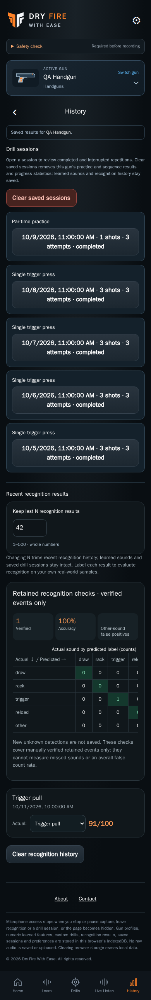

# History design

CHG-037: this screen uses the common app layout and screen wrapper, shared branded header with Settings, informational footer and fixed five-tab navigation. Context controls remain screen-specific. [Layout requirements](../../../requirements/page-layout.md), [template architecture](../../../architecture/page-templates.md) and [reviewed current captures](../../baselines/page-templates-review.json) define the current shell; earlier entries below retain historical evidence.

CHG-032 public availability: omit the advanced chart/group/range/table section while keeping saved-session text timings/review, recognition results and separate clear controls. Full preview retains the graphs. [Edition specification](../../../requirements/build-editions.md).

CHG-031: About/Contact footer controls are pure white in Dark (`#FFFFFF`); Light/disclosure colors and the existing layout/underline/focus/divider remain. [ABOUT-05](../../../requirements/about.md) and the [shared footer design](../shared/README.md) define the correction. [Current capture review](../../baselines/bright-footer-validation.json) records the passing pinned runs; publication is tracked separately.

CHG-030 typography revision: primary Dark text uses `#FFFFFF` throughout this screen and neutral controls. Secondary/footer/accent colors and Light values remain. The [shared typography design](../shared/README.md) and [SET-07](../../../requirements/settings.md) define the palette; [current capture/build review](../../baselines/white-primary-validation.json) records the passing pinned runs; publication is tracked separately.

CHG-029 capture refresh: current references use the pinned production-build renderer and separate centered About/Contact footer controls. [Capture/build review](../../baselines/separate-pages-validation.json) records both passing 138-check runs and reviewed images; earlier [CHG-028 evidence](../../baselines/footer-entry-validation.json) retains the combined entry.

Current implemented layout · CHG-020 deletion/clear correction · 2026-10-11 · exact reviewed UI source hashes are in the registry; published source [`7240e2c`](https://github.com/matosaru/dryfire/commit/7240e2c); external CI/deployment evidence is in the project tracker

Entry: History tab or Home card. App anchor: `historyView`. This is a state of the same `/` web app, not a separate indexable URL.

## Layout and interaction

Per-gun comparable drill/settings and time-range filters, session count/mean/median/spread, trend chart and accessible data table. Saved legacy/practice cards reopen their respective Review. Recent retained recognition checks have explicit verified-only limitations and last-N control (1–500). The saved-session section has a clearly separated Clear saved sessions button and a visible result/status line; confirmation covers all of this gun’s practice/sequence sessions and progress statistics. The recent-recognition section labels its action Clear recognition history with a separate outcome line. Clearing/trimming recognition results preserves saved sessions and learned sounds; explicitly clearing sessions preserves recognition history, sounds and presets. Both actions refresh their own logs and statistics immediately and preserve other guns. CHG-020 is implemented and locally validated; production/device evidence remains separate. No comparable data shows an honest empty/insufficient state.

Validation and publication: [CHG-020 delivery evidence](../../../project/implementation-history.md#chg-020--local-acceptance-2026-10-11).

CHG-021 browser check: at 320 px, the progress-filter grid uses one explicitly shrinkable column and native selectors stay within the card. Paint containment on these native selectors prevents their long option text from expanding the page in WebKit; all option labels, native arrows, focus and selection remain available. Tables may scroll inside their containers; the page must not scroll horizontally. Browser-specific narrow-width evidence and filtering checks are maintained with the [screenshot baselines](../../baselines/README.md).

Functional specifications: [core](../../../requirements/core.md) · [practice-improvements](../../../requirements/practice-improvements.md) · [persistence](../../../requirements/persistence.md). These define acceptance behavior and input bounds; the layout here does not introduce a second set of requirement IDs.

## Current visual references

The chart/table captures below are full-preview evidence; public overview/clear captures retain the text history.

| Screen/state | Capture | App anchor |
| --- | --- | --- |
| Public saved-session text, Dark | [`overview.dark.png`](overview.dark.png) | `savedSessions` |
| Public saved-session text, Light | [`overview.light.png`](overview.light.png) | `savedSessions` |
| Progress charts, Dark (full preview) | [`progress.dark.png`](progress.dark.png) | `progressContent` |
| Accessible chart data table | [`data-table.dark.png`](data-table.dark.png) | `progressContent` |
| Recognition cleared; sessions retained | [`recognition-cleared.dark.png`](recognition-cleared.dark.png) | `historyClearOutcome` |
| Sessions cleared; recognition retained | [`sessions-cleared.dark.png`](sessions-cleared.dark.png) | `sessionsClearOutcome` |
| Progress charts, Light | [`progress.light.png`](progress.light.png) | `progressContent` |

Captured from the reviewed public/full build in pinned Chromium at a 390 px mobile width; shared states use public, and edition-specific states follow the registry. Overview captures use a 1400 px viewport; full-content captures expand the viewport height so fixed bottom navigation does not obscure controls midway through a long image. QA gun names, sample counts, audio levels and timing statistics are illustrative fixtures. Captures are actual UI rather than generated concepts; they do not establish Cloudflare deployment, real iPhone recognition accuracy or legal clearance. Additional transient/error states use this same layout and the linked requirements.

For a visible change, update the affected captures, this Markdown and the [screen registry](../../../architecture/screen-map.json); run the [maintenance checks](../../../architecture/README.md). Earlier reviewed revisions remain in the [archive](../../archive/README.md) and immutable Git history.

CHG-021 diagnosis: reversible layout probes isolated the overflow to the native comparison selector, not the closed chart-data table. Selector paint containment reduces the measured page width from 370 to 320 px in the pinned WebKit diagnostic. Full unchanged rendering and filter interaction verification follow; no whole-page clipping is used.
