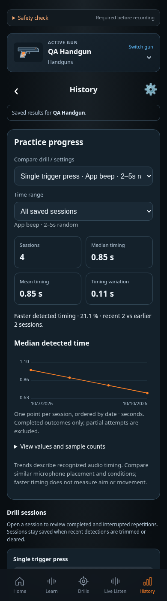

# History design

Current implemented layout · CHG-020 deletion/clear correction · 2026-10-11 · exact reviewed UI source hashes are in the registry; published source [`7240e2c`](https://github.com/matosaru/dryfire/commit/7240e2c); external CI/deployment evidence is in the project tracker

Entry: History tab or Home card. App anchor: `historyView`. This is a state of the same `/` web app, not a separate indexable URL.

## Layout and interaction

Per-gun comparable drill/settings and time-range filters, session count/mean/median/spread, trend chart and accessible data table. Saved legacy/practice cards reopen their respective Review. Recent retained recognition checks have explicit verified-only limitations and last-N control (1–500). The saved-session section has a clearly separated Clear saved sessions button and a visible result/status line; confirmation covers all of this gun’s practice/sequence sessions and progress statistics. The recent-recognition section labels its action Clear recognition history with a separate outcome line. Clearing/trimming recognition results preserves saved sessions and learned sounds; explicitly clearing sessions preserves recognition history, sounds and presets. Both actions refresh their own logs and statistics immediately and preserve other guns. CHG-020 is implemented and locally validated; production/device evidence remains separate. No comparable data shows an honest empty/insufficient state.

Validation and publication: [CHG-020 delivery evidence](../../../project/implementation-history.md#chg-020--local-acceptance-2026-10-11).

CHG-021 browser check: at 320 px, the progress-filter grid uses one explicitly shrinkable column and native selectors stay within the card. Tables may scroll inside their containers; the page must not scroll horizontally. This restores the existing mobile layout without hiding controls or changing filtering/data. Browser-specific narrow-width evidence is maintained with the [screenshot baselines](../../baselines/README.md).

Functional specifications: [core](../../../requirements/core.md) · [practice-improvements](../../../requirements/practice-improvements.md) · [persistence](../../../requirements/persistence.md). These define acceptance behavior and input bounds; the layout here does not introduce a second set of requirement IDs.

## Current visual references

| Screen/state | Capture | App anchor |
| --- | --- | --- |
| Progress charts, Dark | [`progress.dark.png`](progress.dark.png) | `progressContent` |
| Accessible chart data table | [`data-table.dark.png`](data-table.dark.png) | `progressContent` |
| Recognition cleared; sessions retained | [`recognition-cleared.dark.png`](recognition-cleared.dark.png) | `historyClearOutcome` |
| Sessions cleared; recognition retained | [`sessions-cleared.dark.png`](sessions-cleared.dark.png) | `sessionsClearOutcome` |
| Progress charts, Light | [`progress.light.png`](progress.light.png) | `progressContent` |

Captured from the current local production build in Chromium at a 390 px mobile width. Overview captures use a 1400 px viewport; full-content captures expand the viewport height so fixed bottom navigation does not obscure controls midway through a long image. QA gun names, sample counts, audio levels and timing statistics are illustrative fixtures. Captures are actual UI rather than generated concepts; they do not establish Cloudflare deployment, real iPhone recognition accuracy or legal clearance. Additional transient/error states use this same layout and the linked requirements.

For a visible change, update the affected captures, this Markdown and the [screen registry](../../../architecture/screen-map.json); run the [maintenance checks](../../../architecture/README.md). Earlier reviewed revisions remain in the [archive](../../archive/README.md) and immutable Git history.
