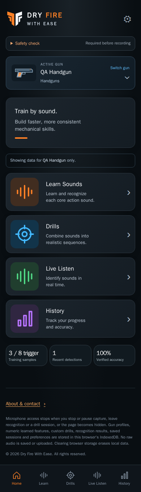

# Home design

CHG-028 capture refresh: current references use the pinned production-build renderer and the independent About & contact footer entry. [Capture/build evidence](../../baselines/footer-entry-validation.json) records both 130-check runs and reviewed images.

Current implemented layout · CHG-018 coverage audit / CHG-019 corrections · 2026-10-11 · CHG-023 footer published in [`dbf8687`](https://github.com/matosaru/dryfire/commit/dbf8687); earlier feature baseline [`aacdb18`](https://github.com/matosaru/dryfire/commit/aacdb18); exact reviewed file hashes are in the registry

Entry: After gun selection/setup and returning visits. App anchor: `homeView`. This is a state of the same `/` web app, not a separate indexable URL.

## Layout and interaction

Compact DF / WITH EASE header, Settings gear, illustrated active-gun switcher with the selected type, Learn/Drills/Live Listen/History cards and gun-specific summary counts. Bottom navigation has five destinations. CHG-028 adds a separate About & contact link at the start of the app footer, opening its independent screen directly without Settings.

Functional specifications: [core](../../../requirements/core.md) · [branding](../../../requirements/branding.md) · [gun-profiles](../../../requirements/gun-profiles.md) · [About](../../../requirements/about.md). These define acceptance behavior and input bounds; the layout here does not introduce a second set of requirement IDs.

## Current visual references

| Screen/state | Capture | App anchor |
| --- | --- | --- |
| Dashboard | [`overview.dark.png`](overview.dark.png) | `homeView` |

Captured from the current local production build in Chromium at a 390 px mobile viewport. QA gun names, sample counts, audio levels and timing statistics are illustrative fixtures. Captures are actual UI rather than generated concepts; they do not establish Cloudflare deployment, real iPhone recognition accuracy or legal clearance. Additional transient/error states use this same layout and the linked requirements.

For a visible change, update the affected captures, this Markdown and the [screen registry](../../../architecture/screen-map.json); run the [maintenance checks](../../../architecture/README.md). Earlier reviewed revisions remain in the [archive](../../archive/README.md) and immutable Git history.
