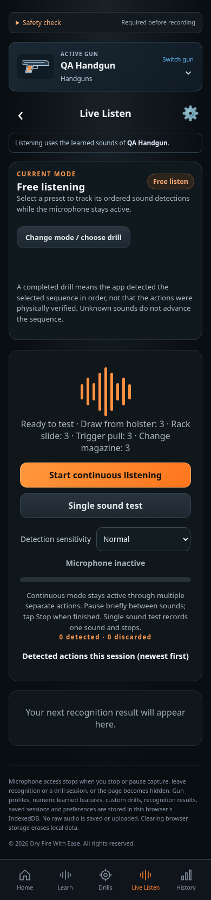

# Live Listen design

Current implemented layout · CHG-018 coverage audit / CHG-019 corrections · 2026-10-11 · CHG-023 local footer revision; earlier feature baseline [`aacdb18`](https://github.com/matosaru/dryfire/commit/aacdb18); exact reviewed file hashes are in the registry

Entry: Live Listen tab, Home card or Start free listening. App anchor: `recognizeView`. This is a state of the same `/` web app, not a separate indexable URL.

## Layout and interaction

Free-listening/sequence selection, current event and score, level/waveform, single sound test and continuous Start/Stop controls. Continuous capture remains active through separate events until stopped or left. Unknown input stays transient; accepted known results can be verified in History. Microphone level does not establish that a click was recognized.

Functional specifications: [core](../../../requirements/core.md) · [practice-modes](../../../requirements/practice-modes.md) · [practice-improvements](../../../requirements/practice-improvements.md). These define acceptance behavior and input bounds; the layout here does not introduce a second set of requirement IDs.

## Current visual references

| Screen/state | Capture | App anchor |
| --- | --- | --- |
| Ready to listen | [`ready.dark.png`](ready.dark.png) | `recognizeView` |
| Continuous listening | [`listening.dark.png`](listening.dark.png) | `listeningIndicator` |

Captured from the current local production build in Chromium at a 390 px mobile viewport. QA gun names, sample counts, audio levels and timing statistics are illustrative fixtures. Captures are actual UI rather than generated concepts; they do not establish Cloudflare deployment, real iPhone recognition accuracy or legal clearance. Additional transient/error states use this same layout and the linked requirements.

For a visible change, update the affected captures, this Markdown and the [screen registry](../../../architecture/screen-map.json); run the [maintenance checks](../../../architecture/README.md). Earlier reviewed revisions remain in the [archive](../../archive/README.md) and immutable Git history.
