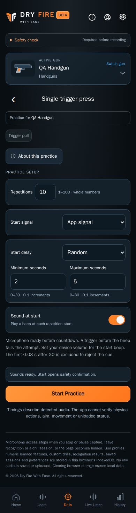

# Practice design

CHG-031: About/Contact footer controls are pure white in Dark (`#FFFFFF`); Light/disclosure colors and the existing layout/underline/focus/divider remain. [ABOUT-05](../../../requirements/about.md) and the [shared footer design](../shared/README.md) define the correction. Capture review and publication are recorded in the [delivery tracker](../../../project/implementation-history.md).

CHG-030 typography revision: primary Dark text uses `#FFFFFF` throughout this screen and neutral controls. Secondary/footer/accent colors and Light values remain. The [shared typography design](../shared/README.md) and [SET-07](../../../requirements/settings.md) define the palette; [current capture/build review](../../baselines/white-primary-validation.json) records the passing pinned runs; publication is tracked separately.

CHG-029 capture refresh: current references use the pinned production-build renderer and separate centered About/Contact footer controls. [Capture/build review](../../baselines/separate-pages-validation.json) records both passing 138-check runs and reviewed images; earlier [CHG-028 evidence](../../baselines/footer-entry-validation.json) retains the combined entry.

Current implemented layout · CHG-022 microphone/start corrections · 2026-10-11 · local source revision; previous published baseline [`aacdb18`](https://github.com/matosaru/dryfire/commit/aacdb18); exact reviewed file hashes are in the registry

Entry: Six mode cards or saved practice review in History. App anchor: `practiceView`. This is a state of the same `/` web app, not a separate indexable URL.

## Layout and interaction

Configure exposes only mode-relevant count/duration/par/endpoints, app/external start source, fixed/random delay, beep and readiness. Single defaults to ten automatic repetitions with fresh random 2–5-second countdown/signal/first accepted trigger each time. Running uses STOP and the microphone meter below when capture is live; Pause releases capture. Par/Reload offer Next between resolved attempts; repeated/control/free remain continuous. Review shows saved outcomes and Repeat / Back to Drills. Histories use actual previous-screen Back and never restart capture on refresh.

Other required states: Connecting; cancel/end remains available; External-cue waiting; live input until calibrated cue starts timing; Finishing a deadline; late events rejected by onset time; Manual Next for Par/Reload only; Saving error; Retry and navigation recovery guard.

Functional specifications: [practice-modes](../../../requirements/practice-modes.md) · [practice-improvements](../../../requirements/practice-improvements.md) · [persistence](../../../requirements/persistence.md). These define acceptance behavior and input bounds; the layout here does not introduce a second set of requirement IDs.

CHG-022 implemented revision: Connecting waits for actual incoming audio before countdown. Countdown retains seconds/STOP and adds the live microphone meter below; GO keeps the same STOP/meter. Single early clicks produce **Miss · early trigger** in the latest result and saved Review, followed automatically by a fresh delay until the target. Configure explains that input is monitored before the beep and that the device volume controls audible output. The timing/data rules and acceptance criteria are in [practice-start](../../../requirements/practice-start.md); The actual production-build captures below show this revision. Earlier captures are retained under CHG-022 in the archive.

## Current visual references

| Screen/state | Capture | App anchor |
| --- | --- | --- |
| Configure single | [`configure-single.dark.png`](configure-single.dark.png) | `practiceConfigure` |
| Configure repeated | [`configure-repeated.dark.png`](configure-repeated.dark.png) | `practiceConfigure` |
| Configure par | [`configure-par.dark.png`](configure-par.dark.png) | `practiceConfigure` |
| Configure control | [`configure-control.dark.png`](configure-control.dark.png) | `practiceConfigure` |
| Configure reload | [`configure-reload.dark.png`](configure-reload.dark.png) | `practiceConfigure` |
| Configure free | [`configure-free.dark.png`](configure-free.dark.png) | `practiceConfigure` |
| Fresh ready countdown | [`countdown.dark.png`](countdown.dark.png) | `practiceRun` |
| Listening with STOP and microphone | [`active.dark.png`](active.dark.png) | `practiceRun` |
| Light theme listening | [`active.light.png`](active.light.png) | `practiceRun` |
| Paused microphone inactive | [`paused.dark.png`](paused.dark.png) | `practiceRun` |
| Early-trigger failed review | [`early-review.dark.png`](early-review.dark.png) | `practiceReview` |
| Saved practice review | [`review.dark.png`](review.dark.png) | `practiceReview` |

Captured from the current local production build in Chromium at a 390 px mobile viewport. QA gun names, sample counts, audio levels and timing statistics are illustrative fixtures. Captures are actual UI rather than generated concepts; they do not establish Cloudflare deployment, real iPhone recognition accuracy or legal clearance. Additional transient/error states use this same layout and the linked requirements.

For a visible change, update the affected captures, this Markdown and the [screen registry](../../../architecture/screen-map.json); run the [maintenance checks](../../../architecture/README.md). Earlier reviewed revisions remain in the [archive](../../archive/README.md) and immutable Git history.
