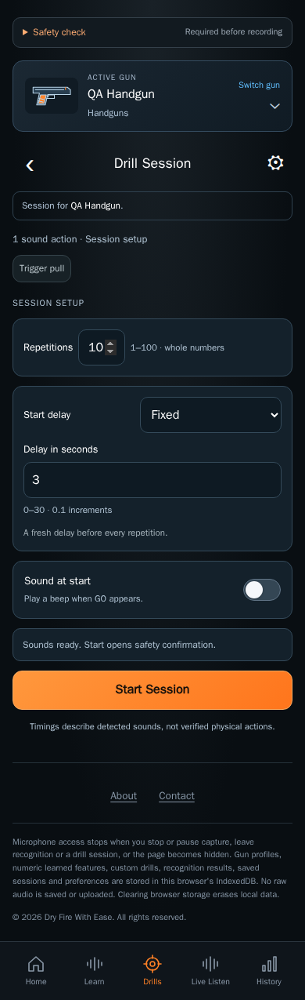

# Drill Session design

CHG-029 capture refresh: current references use the pinned production-build renderer and separate centered About/Contact footer controls. Current validation is recorded in the [delivery tracker](../../../project/implementation-history.md); earlier [CHG-028 evidence](../../baselines/footer-entry-validation.json) retains the combined entry.

Current implemented layout · CHG-018 coverage audit / CHG-019 corrections · 2026-10-11 · CHG-023 footer published in [`dbf8687`](https://github.com/matosaru/dryfire/commit/dbf8687); earlier feature baseline [`aacdb18`](https://github.com/matosaru/dryfire/commit/aacdb18); exact reviewed file hashes are in the registry

Entry: Start Drill on a built-in/custom sequence, or History review. App anchor: `sessionView`. This is a state of the same `/` web app, not a separate indexable URL.

## Layout and interaction

Keep the ordered sequence visible once. Configure exposes repetitions (default ten), fixed/random delay (default fixed three seconds), Sound at start (default Off), readiness and Start Session. Require only referenced sound types. Run shows completed/left, countdown/GO, latest repetition and Pause/Resume/End. Legacy GO is a status; the Practice STOP correction does not replace this runner. Each ordered completion is saved and followed by a fresh countdown. Review shows totals and repetition/split details, Repeat Session and Back to Drills.

Functional specifications: [drill-sessions](../../../requirements/drill-sessions.md) · [practice-improvements](../../../requirements/practice-improvements.md) · [persistence](../../../requirements/persistence.md). These define acceptance behavior and input bounds; the layout here does not introduce a second set of requirement IDs.

## Current visual references

| Screen/state | Capture | App anchor |
| --- | --- | --- |
| Configure sequence | [`configure.dark.png`](configure.dark.png) | `sessionConfigure` |
| Active sequence | [`active.dark.png`](active.dark.png) | `sessionRun` |
| Paused sequence | [`paused.dark.png`](paused.dark.png) | `sessionRun` |
| Saved sequence review | [`review.dark.png`](review.dark.png) | `sessionReview` |

Captured from the current local production build in Chromium at a 390 px mobile viewport. QA gun names, sample counts, audio levels and timing statistics are illustrative fixtures. Captures are actual UI rather than generated concepts; they do not establish Cloudflare deployment, real iPhone recognition accuracy or legal clearance. Additional transient/error states use this same layout and the linked requirements.

For a visible change, update the affected captures, this Markdown and the [screen registry](../../../architecture/screen-map.json); run the [maintenance checks](../../../architecture/README.md). Earlier reviewed revisions remain in the [archive](../../archive/README.md) and immutable Git history.
