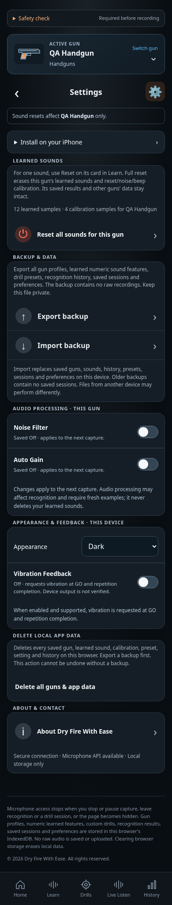

# Settings design

CHG-037: this screen uses the common app layout and screen wrapper, shared branded header with Settings, informational footer and fixed five-tab navigation. Context controls remain screen-specific. [Layout requirements](../../../requirements/page-layout.md), [template architecture](../../../architecture/page-templates.md) and [reviewed current captures](../../baselines/page-templates-review.json) define the current shell; earlier entries below retain historical evidence.

CHG-035: private preview alone adds **Test as: Free / Full** at the top of Settings and a footer mode indicator. CHG-038 starts the dev preview in Full (five guns/custom creation/charts); an explicit Free choice reproduces the two-gun public rules and is retained on refresh. Existing explicit preferences remain. Disabled during active work; mode changes preserve saved data. Public HTML omits these controls. Live Access and deployment are tracked separately in the [guide](../../../development/private-preview-deployment.md).

CHG-031: About/Contact footer controls are pure white in Dark (`#FFFFFF`); Light/disclosure colors and the existing layout/underline/focus/divider remain. [ABOUT-05](../../../requirements/about.md) and the [shared footer design](../shared/README.md) define the correction. [Current capture review](../../baselines/bright-footer-validation.json) records the passing pinned runs; publication is tracked separately.

CHG-030 typography revision: primary Dark text uses `#FFFFFF` throughout this screen and neutral controls. Secondary/footer/accent colors and Light values remain. The [shared typography design](../shared/README.md) and [SET-07](../../../requirements/settings.md) define the palette; [current capture/build review](../../baselines/white-primary-validation.json) records the passing pinned runs; publication is tracked separately.

CHG-029 capture refresh: current references use the pinned production-build renderer and separate centered About/Contact footer controls. [Capture/build review](../../baselines/separate-pages-validation.json) records both passing 138-check runs and reviewed images; earlier [CHG-028 evidence](../../baselines/footer-entry-validation.json) retains the combined entry.

Current implemented layout · CHG-018 coverage audit / CHG-019 corrections · 2026-10-11 · CHG-023 footer published in [`dbf8687`](https://github.com/matosaru/dryfire/commit/dbf8687); earlier feature baseline [`aacdb18`](https://github.com/matosaru/dryfire/commit/aacdb18); exact reviewed file hashes are in the registry

Entry: Settings gear in the shared branded header; backup/restore links. App anchor: `settingsView`. This is a state of the same `/` web app, not a separate indexable URL.

## Layout and interaction

Distinct confirmed selected-gun sound reset with visible learned/calibration counts and result; whole-library backup export/import; supported per-gun Noise Filter/Auto Gain and device-wide themes/vibration. A separate Delete all guns & app data action states every store deleted, recommends exporting first, and requires confirmation before atomic reset/restart. Cancel deletes nothing. Sound reset retains guns, presets/results and other guns. Unsupported capabilities are disclosed; Install explains local-data and microphone limits. CHG-028 keeps a Device information group with capability status. About and Contact have separate centered shared-footer controls outside Settings, opening their independent screens directly. Link colors are white in Dark and footer-matching in Light; a divider separates them from the disclosure.

Functional specifications: [settings](../../../requirements/settings.md) · [core](../../../requirements/core.md) · [persistence](../../../requirements/persistence.md) · [About](../../../requirements/about.md) · [Contact](../../../requirements/contact.md). These define acceptance behavior and input bounds; the layout here does not introduce a second set of requirement IDs.

## Current visual references

| Screen/state | Capture | App anchor |
| --- | --- | --- |
| Private preview, free, dark | [`preview-free.dark.png`](preview-free.dark.png) | `previewTestingSection` |
| Private preview, free, light | [`preview-free.light.png`](preview-free.light.png) | `previewTestingSection` |
| Private preview, full, dark | [`preview-full.dark.png`](preview-full.dark.png) | `previewTestingSection` |
| Private preview, full, light | [`preview-full.light.png`](preview-full.light.png) | `previewTestingSection` |
| Expanded installation help, Dark | [`installation-help.dark.png`](installation-help.dark.png) | `installStatus` |
| Expanded installation help, Light | [`installation-help.light.png`](installation-help.light.png) | `installStatus` |
| Settings, Dark | [`overview.dark.png`](overview.dark.png) | `settingsView` |
| Settings, Light | [`overview.light.png`](overview.light.png) | `settingsView` |
| Completed selected-gun sound reset | [`sounds-reset.dark.png`](sounds-reset.dark.png) | `soundResetOutcome` |

CHG-029 captures come from the production build in pinned Chromium at 390 px, with the shared footer also reviewed at 320 px and in WebKit. [Current rendering evidence](../../baselines/separate-pages-validation.json) retains source/collection details. QA gun names, sample counts, audio levels and timing statistics are illustrative fixtures. Captures are actual UI rather than generated concepts; they do not establish Cloudflare deployment, real iPhone recognition accuracy or legal clearance. Additional transient/error states use this same layout and the linked requirements.

For a visible change, update the affected captures, this Markdown and the [screen registry](../../../architecture/screen-map.json); run the [maintenance checks](../../../architecture/README.md). Earlier reviewed revisions remain in the [archive](../../archive/README.md) and immutable Git history.

CHG-037 uses the shared branded header, reusable page wrapper and fixed five-tab navigation. Installation help remains an expandable Settings section using the same shell. Current Dark/Light expanded-help captures and updated existing states are reviewed in the pinned collection; [layout requirements](../../../requirements/page-layout.md) own the architecture.
