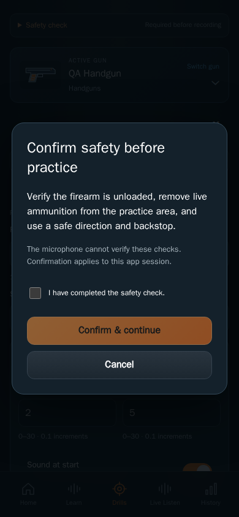

# Safety confirmation design

CHG-030 shared typography: resolved Dark mode uses **`#FFFFFF` / `rgb(255, 255, 255)`** for primary headings/content and neutral control labels/values throughout the app, including session/practice/history primary text. A shared Dark-only primary-text token covers inherited text and existing explicit near-white overrides. Muted copy, footer links (`#8594A4`), semantic accents/status colors and dark labels on orange buttons retain their colors. Light mode retains its existing palette. Font sizes, layout, focus outlines, navigation and stored data stay intact. [SET-07](../../../requirements/settings.md) records the directly requested palette revision; all affected Dark production-build references are refreshed/reviewed in the pinned renderer. [Current color/capture evidence](../../baselines/white-primary-validation.json) and the [build manifest](../../baselines/white-primary-build-manifest.json) retain provenance; existing Light references remain untouched and publication is tracked separately.

CHG-029 shared footer: two separate **About** and **Contact** controls are centered in a row above the data disclosure. Each opens its independent informational screen without visiting Settings, including before gun setup. Both remain visible on both pages; the current page has `aria-current="page"`. Remove the arrow. Preserve the 0.85rem font, underline, 44px minimum target and 2px keyboard focus outline with 3px offset. Match footer text: Dark `#8594a4`, Light `#4a6276`. A 1px divider below the row separates links from disclosure text, using the existing theme border colors. The privacy/copyright text and five main practice destinations remain. [About](../../../requirements/about.md) and [Contact](../../../requirements/contact.md) specify the pages. All affected production-build captures are refreshed/reviewed in both pinned browsers; [capture evidence](../../baselines/separate-pages-validation.json) and [delivery status](../../../project/implementation-history.md) are tracked separately.

CHG-023 shared footer: every functional screen retains its data/microphone disclosure, followed by **© 2026 Dry Fire With Ease. All rights reserved.** in the same readable footer style. It wraps naturally on narrow screens and supports the existing Dark/Light themes. The notice belongs to the shared page layout; it creates no new screen or public route. Current captures are refreshed with the footer; the modal still uses the same acknowledgement/continuation rules.

Current implemented layout · CHG-018 coverage audit · 2026-10-11 · CHG-023 source published in [`dbf8687`](https://github.com/matosaru/dryfire/commit/dbf8687); exact reviewed file hashes are in the registry

Entry: Any unconfirmed action that would acquire microphone capture. App anchor: `safetyModal`. This is a state of the same `/` web app, not a separate indexable URL.

## Layout and interaction

Native accessible modal with explicit safety text, acknowledgement checkbox, disabled Confirm & continue until checked and Cancel. Confirm resumes the original action exactly once; Cancel or changed context does not start capture. Acknowledgement is page-session-local, resets on refresh or gun change, and is never a permanent waiver. The disclosure remains available for reviewing the checklist.

Functional specifications: [core](../../../requirements/core.md) · [practice-improvements](../../../requirements/practice-improvements.md). These define acceptance behavior and input bounds; the layout here does not introduce a second set of requirement IDs.

## Current visual references

| Screen/state | Capture | App anchor |
| --- | --- | --- |
| Unconfirmed capture action | [`safety-modal.dark.png`](safety-modal.dark.png) | `safetyModal` |

Captured from the current local production build in Chromium at a 390 px mobile viewport. QA gun names, sample counts, audio levels and timing statistics are illustrative fixtures. Captures are actual UI rather than generated concepts; they do not establish Cloudflare deployment, real iPhone recognition accuracy or legal clearance. Additional transient/error states use this same layout and the linked requirements.

For a visible change, update the affected captures, this Markdown and the [screen registry](../../../architecture/screen-map.json); run the [maintenance checks](../../../architecture/README.md). Earlier reviewed revisions remain in the [archive](../../archive/README.md) and immutable Git history.
