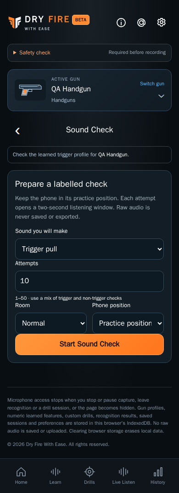

# Sound Check

CHG-063 adds a labelled, gun-owned check reached from the Trigger profile card. Setup records the expected sound, attempt count (1–50), room and phone position. The microphone reaches ambient readiness before **Begin attempt** becomes available. Each attempt arms recognition for two seconds; detection is disarmed between attempts.

Review shows version-two matched triggers, misses, false shots and duplicates for this check only. When at least three newly recorded spectral trigger samples exist, the same captured events also show a version-three shadow comparison. The candidate never changes practice results. Exported JSON contains labels, versioned numeric feature vectors, decisions, timing and the supplied device/session conditions; it contains no PCM, gun name or raw recording.

The shared header, footer, fixed navigation, active-gun context, safety confirmation and acoustic limitations follow [shared layout](../shared/README.md). Behavior is specified by [audio recognition v3](../../../requirements/audio-recognition-v3.md), [core safety and capture](../../../requirements/core.md), and [page layout](../../../requirements/page-layout.md).
